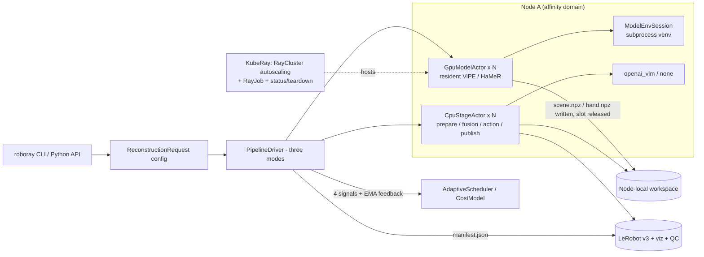

# RoboRay

A Ray pipeline that turns egocentric (first-person) video into training-ready
[LeRobot v3](https://github.com/huggingface/lerobot) datasets.

RoboRay takes a batch of raw egocentric clips (stereo or monocular) and produces,
for every episode: a genuine LeRobot v3 dataset written through the public `lerobot`
API, camera and 3D-world visualization videos, a per-episode QC report, and a
run-level manifest that indexes all artifacts together with timing and scheduling
evidence.

```
raw video ─▶ prepare ─▶ [ scene ∥ hand ]  (parallel GPU inference)
                │              │
                └──▶ fusion ──▶ action ──▶ publish ─▶ LeRobot v3 + viz + QC + manifest.json
```

- **Stage 1 — Ingest & preparation.** Decode, validate, timestamp-align (nearest-neighbor
  pairing) and calibrate-normalize raw media into a node-local workspace; each episode's
  media is prepared once per node and reused by later stages.
- **Stage 2 — Scene & hand reconstruction.** Two independent GPU actor pools: scene runs
  ViPE / Fast-FoundationStereo for camera poses and metric depth; hand runs HaMeR+MANO
  for wearer hand observations. Both are fused in metric space, pose-optimized, and
  gap-completed into world-frame hand motion.
- **Stage 3 — Action understanding & dataset generation.** Builds an action timeline
  from world-frame hand motion, extracts action semantics via an OpenAI-compatible VLM
  (AI Function), and emits flattened state/action tensors.
- **Stage 4 — Visualization, publishing & QC.** Episodes publish in completion order:
  training data, visualization views, and a QC report (reprojection error curves, depth
  source statistics, per-frame diagnostics, completion audit) are delivered together.

## Key capabilities

**Algorithms**

- **A1 — Stereo metric fusion.** Back-projects MANO metric skeletons into the world and
  anchors root depth on fused scene depth; recovers global orientation with scale-free
  Kabsch rigid alignment (explicit condition-number check falls back to root translation
  on degenerate cases). Avoids monocular scale drift for close-range hand localization.
- **A2 — Multi-person hand association.** Egocentric frames can contain hands from more
  than one person. A pure-function associator binds detections to the wearer's two
  entity slots using a wearer prior (bottom-center proximity + bbox area), per-slot
  motion nearest-neighbor tracking, left/right labels as tie-breaking only (so crossed
  hands do not swap identity), hysteresis re-selection, and exclusive binding (two slots
  never share a candidate). Association runs before gap completion and world projection;
  label-consistent reordering keeps geometry and identity coherent in multi-person frames.
- **A3 — Short-gap completion.** Brief detection dropouts (occlusion, motion blur, score
  dips) are filled only when all three conditions hold: trusted observations at both
  ends, the same hand on both sides, and gap duration within the cap (default 0.2 s).
  Filled segments must then pass four checks — keypoint depth support, field of view,
  wrist displacement, trajectory deviation — or they are dropped. Keeping a gap is
  preferred over hallucinating motion.

**Ray**

- **Serverless-style elastic resource model.** Run against a resident autoscaling
  `RayCluster` or submit a one-shot `RayJob` (K8sJobMode) — no cluster infrastructure to
  build or babysit. CPU and GPU worker groups scale from zero; idle nodes are reclaimed
  after 300 s (three-tier idle policy: unload model at 30 s, exit actors at 240 s,
  reclaim nodes at 300 s).
- **Actor execution model.** Every episode's every stage runs on an actor. GPU slots are
  released as soon as model artifacts hit disk, so post-processing and the next episode's
  inference overlap on the same timeline.
- **Node-local data reuse.** Media, prepared frames, and intermediate arrays stay in a
  node-local workspace; scene and hand arrays fuse locally on the node that produced
  them — no large-array transfers across nodes. Episodes are pinned to nodes
  (affinity domains) and routed accordingly.

Measured three-tier speedups (serial baseline → cross-stage pipelining → + adaptive
scheduling) and the cross-stage overlap evidence are documented in
[`docs/bench/bench_report.md`](docs/bench/bench_report.md),
[`docs/bench/2026-10-26-bench-results.md`](docs/bench/2026-10-26-bench-results.md), and
[`docs/superpowers/plans/D-l3-results.md`](docs/superpowers/plans/D-l3-results.md).

## Architecture



Real models run in **isolated per-model conda environments** (they require mutually
incompatible torch/CUDA stacks) driven through a subprocess + JSON-lines protocol by
`ModelEnvSession`; adapters normalize each model's outputs into shared
`SceneArtifact` / `HandArtifact` contracts. The adaptive scheduler dispatches on four
signals (pending work, predicted cost, available resources, resident models) with an EMA
feedback loop that recalibrates predictions from actual service times.

### Repository layout

```
src/roboray/
├── api/           # ReconstructionRequest config + EgoReconstruction Python facade
├── runtime/       # PipelineDriver orchestration, episode state machine, planner, storage
├── ray_runtime/   # GpuModelActor / CpuStageActor, node pools (affinity, least-loaded, self-healing)
├── scheduling/    # AdaptiveScheduler, EMA cost model, idle policy (pure functions)
├── models/        # model-env subprocess sessions + ViPE / FFS / HaMeR / VLM adapters
├── stages/        # prepare, scene, hand, fusion (A1/A2/A3), action, publish
├── export/        # LeRobot v3 writer (subprocess export via the lerobot package)
├── viz/           # camera / world / timeline views, QC plots
└── manifest.py    # run manifest: per-stage timings, scheduler snapshots, timeline
```

## Quickstart (local, no GPU)

```bash
conda create -y -n roboray python=3.10
conda activate roboray
pip install -e ".[dev]"

pytest                                                  # unit + local end-to-end (GPU tests deselected)
python scripts/make_synthetic_ego.py --out data/synthetic --episodes 3 --frames 30
python scripts/run_local_fake.py --config configs/local-fake.yaml
```

The local fake config routes export through a stub script, so the full orchestration
 path is exercisable on a CPU-only machine.

> The LeRobot export interpreter must be provided via the config's `models:` section.
> A shell `export ROBORAY_LEROBOT_PYTHON=...` is **overridden by `runtime_env` and has
> no effect** on Ray workers.

## Real models (GPU required)

```bash
pip install -e ".[dev,models]"
roboray run --config configs/default.yaml --ray-address auto
```

The complete integration guide is **[`docs/models.md`](docs/models.md)**: per-model conda
env build scripts (`deploy/modelenvs/build_{vipe,ffs,hamer}.sh`), weight acquisition
(HuggingFace downloads and the registration-required `MANO_RIGHT.pkl`), the
`ROBORAY_*` environment variable reference, the L2 verification checklist, and the GPU
smoke command:

```bash
ROBORAY_GPU_SMOKE=1 conda run -n roboray python -m pytest -m gpu
```

## Deploy on Kubernetes (KubeRay)

Build a self-contained image (app + per-model conda envs + vendored repos + prefetched
weights) from `deploy/`, push it to your registry, then:

```bash
# 1) Run a namespace-scoped KubeRay operator (a pre-installed platform operator may be
#    restricted with --watch-namespace)
bash deploy/k8s/setup_operator.sh
# 2) Resident cluster: submit a RayCluster (CPU-only head; 1 GPU per worker pod, autoscaling)
IMAGE=registry.example.com/roboray/base:v0.26.0 NODE=node-1 bash deploy/k8s/apply.sh
# 3) One-shot job: submit a RayJob — spins up its own cluster, tears it down when done
IMAGE=registry.example.com/roboray/base:v0.26.0 NODE=node-1 bash deploy/k8s/submit_job.sh
# 4) Idle-capacity check (gate L2/L3 runs on TOTAL_FREE_GPUS > 0 or an autoscaling cluster)
bash deploy/k8s/status.sh
# 5) Tear down
bash deploy/k8s/teardown.sh
```

- **`apply.sh` (resident cluster).** CPU and GPU worker groups both start at 0 replicas
  with `enableInTreeAutoscaling` — idle nodes are reclaimed after 300 s. The head hosts
  no pipeline work (0 Ray logical CPUs).
- **`submit_job.sh` (one-shot).** Submits a RayJob (K8sJobMode): the operator launches a
  submit-client K8s Job pod running `ray job submit`; the Ray driver process itself runs
  in the head container by Ray design. `shutdownAfterJobFinishes` tears the derived
  cluster down automatically. Default entrypoint is `roboray.cli run` (override with
  `ENTRYPOINT`).
- **`status.sh` (GATE semantics).** OPEN if and only if there are idle GPUs ready to use
  **or** a cluster with `enableInTreeAutoscaling: true` exists — a scale-from-zero
  cluster legitimately shows zero steady-state usage.
- **Multi-node migration.** Beyond swapping the `shared-input` / `shared-output` volume
  sections for PVC/NFS, relax the worker groups' pod-level `nodeSelector` (the manifests
  pin it to a single node) — otherwise autoscaling can only ever grow on that one node.
  The `ego` workspace volume may stay a node-local hostPath (see node affinity).

Three hard cluster constraints, all verified on a real 8-GPU A800 node
(details in [`docs/superpowers/plans/D-l2-results.md`](docs/superpowers/plans/D-l2-results.md)):

1. **GPUs are only available inside K8s pods** — a plain `docker run` never sees CUDA.
2. **The user-space driver library `libcuda.so.1` must ship inside the image.**
3. **The default seccomp profile blocks `pthread_create`** — containers cannot create
   even a first thread → set `seccompProfile: Unconfined` /
   `--security-opt seccomp=unconfined`.

## Configuration

Config keys mirror the design document; see [`configs/default.yaml`](configs/default.yaml).
Each stage is independently tunable:

| Key | Meaning | Default |
| --- | --- | --- |
| `execution.max_gpus` | GPUs available to the run | 1 |
| `execution.backend` | `real` uses real models; `test` uses fakes (tests only) | real |
| `stages.scene_reconstruction.stereo_max_image_side_px` | Stereo input resolution cap | 640 |
| `stages.hand_reconstruction.inference_fps` | Hand inference sampling rate (stride sampling) | 30 |
| `stages.hand_reconstruction.wearer_association` | Multi-person wearer association (A2) | true |
| `stages.hand_reconstruction.unobserved_gap_s` | Max short-gap completion duration (s, A3) | 0.2 |
| `stages.hand_reconstruction.min_supporting_joints` | Min supporting joints for completion | 8 |
| `stages.action_understanding.vlm_base_url` | OpenAI-compatible VLM endpoint | null |

## Outputs

```
output/run-xxx/
├── lerobot_v3/<ep_id>/            # genuine LeRobot v3 dataset (written via the public lerobot API)
│   ├── meta/info.json             #   observation.state / action (flattened joints + gripper)
│   ├── data/chunk-000/file-000.parquet
│   └── meta/{stats.json,tasks.parquet,episodes/...}
├── lerobot_v3/<ep_id>.summary.npz # export subprocess __RESULT__ summary (read-back self-check)
├── viz/<ep_id>/camera.mp4         # camera view (original FOV/aspect + 2D keypoint overlay)
├── viz/<ep_id>/world.mp4          # 3D world view (skeleton / camera trajectory / point cloud / 1s wrist forecast)
├── qc/<ep_id>/                    # per-episode QC
│   ├── report.html                #   reprojection curves + depth sources + per-frame diagnostics + completion audit
│   ├── reprojection.png           #   raw curve plot
│   └── segments.json              #   segmentation labels (traceability copy)
└── manifest.json                  # run-level index (timings + scheduling snapshots + timeline)
```

The dataset is **genuine LeRobot v3** (written through the `lerobot` public API,
readable back with `LeRobotDataset`), not a hand-rolled format. Every number in a QC
report comes from `fused.npz`; missing data is stated explicitly — no fake plots.

## Environment variables

Export and VLM are injected via `ROBORAY_*` variables (real-model envs documented in
[`docs/models.md`](docs/models.md)). **The export env must be set in the config's
`models:` section** — it ships to Ray workers via `runtime_env`, and a multi-node
cluster does not inherit the driver's process environment:

| Variable | Config key | Meaning | When unset |
| --- | --- | --- | --- |
| `ROBORAY_MODEL_WORKER` | `execution.model_worker` | Model execution: `resident` workers (weights loaded once) / `oneshot` per-inference subprocess | `"resident"` |
| `ROBORAY_LEROBOT_PYTHON` | `models.lerobot_python` | **Absolute path** to the `ego-lerobot` env interpreter (not an env name) | `"python"` (export fails without `lerobot`) |
| `ROBORAY_LEROBOT_SCRIPT` | `models.lerobot_script` | Override the export script path (**test fakes only**) | in-repo real script |
| `ROBORAY_VLM_BASE_URL` | `action_understanding.vlm_base_url` | Base URL of an OpenAI-compatible VLM service | empty (calls raise `VlmError`) |
| `ROBORAY_VLM_MODEL` | `action_understanding.vlm_model` | VLM model name | `"qwen-vl"` |
| `VLM_API_KEY` (name set by `action_understanding.vlm_api_key_env`) | — | VLM auth key | empty (calls raise `VlmError`) |

The `ego-lerobot` env is built by `deploy/modelenvs/build_lerobot.sh` (Python 3.12 +
CPU torch + `lerobot==0.6.1`). Because conda can be nested, its interpreter path is not
necessarily `$(conda info --base)/envs/ego-lerobot/bin/python` — trust the path echoed
by the build script and `conda env list`.

## Testing

```bash
pytest                        # 360+ tests; GPU-marked tests deselected by default
pytest -m gpu                 # real-model GPU smoke (needs weights + ROBORAY_GPU_SMOKE=1)
RAY_ADDRESS=local pytest      # force a fresh local Ray cluster (avoids attaching to a leftover one)
```

`pyproject.toml` sets `addopts = -m "not gpu"`, so the default run is CPU-only; the CLI
`-m gpu` overrides it (last wins). The full suite runs green on CPU — GPU tests cover
real-model adapters and are run on a GPU machine.

## Documentation

| Document | Contents |
| --- | --- |
| [`docs/models.md`](docs/models.md) | Real-model integration: env builds, weights, env-var reference, L2 checklist, GPU smoke |
| [`docs/superpowers/specs/`](docs/superpowers/specs/) | Design specs (pipeline, Ray runtime completion, audit improvements, bench/VLM overlap) |
| [`docs/superpowers/plans/`](docs/superpowers/plans/) | Implementation plans and verification reports (A–E3, audit, bench campaign) |
| [`docs/bench/`](docs/bench/) | Benchmark evidence: three-tier timing, timeline overlap, cluster regression runs |

## Third-party assets & licenses

- `third_party/*.commit` pin the vendored upstream repos (vipe, fast-foundationstereo,
  hamer); fetch them with `scripts/vendor_models.sh`. They are excluded from Ray
  `working_dir` packaging via `.rayignore`.
- Model weights are **not** included in this repository. Download them from their
  upstream sources and follow each model's license — see [`docs/models.md`](docs/models.md)
  and `deploy/assets/weights/*/README.md`; e.g. Fast-FoundationStereo from HuggingFace
  [`nvidia/c-fast-foundationstereo`](https://huggingface.co/nvidia/c-fast-foundationstereo)
  (NVIDIA Open Model Agreement, research and evaluation use).
- `MANO_RIGHT.pkl` is **not** included (MPI license; register and download it yourself;
  gitignored).

## Known limitations

- Monocular input is supported through a graceful-degradation path; absolute-metric
  claims do not transfer to the monocular baseline (documented in the bench reports).
- The published camera view renders all detected hands, including bystanders' — it is a
  QC artifact, not the training data.
- Known follow-ups and risk register: see
  [`docs/bench/2026-10-27-audit-improvements-report.md`](docs/bench/2026-10-27-audit-improvements-report.md).
